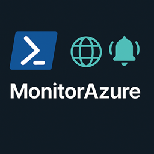

# Monitor Azure Service Tags and Microsoft 365 endpoints



This PowerShell script checks Microsoft's Azure Service Tags and Microsoft 365 Worldwide endpoint feeds, archives new versions, compares them with the previous versions, and writes CSV reports. Email and Teams notifications are optional.

## Requirements

- PowerShell 5.1 or PowerShell 7+
- Internet access to `microsoft.com`, `download.microsoft.com`, and `endpoints.office.com`
- An SMTP server if using email
- A Teams webhook if using Teams notifications

## Run

The script creates the archive and report directories if they do not exist. Email is off by default.

Windows:

```powershell
.\Watch-AzureServiceTags.ps1 `
  -ArchiveRoot "C:\AzureServiceTags\archive" `
  -ReportsRoot "C:\AzureServiceTags\reports" `
  -VerboseOutput
```

Linux:

```bash
pwsh -File ./Watch-AzureServiceTags.ps1 \
  -ArchiveRoot "$HOME/azure-monitor/archive" \
  -ReportsRoot "$HOME/azure-monitor/reports" \
  -VerboseOutput
```

The first run downloads and archives each feed. Reports are generated once the archive contains at least two versions of that feed.

## What it monitors

- **Azure Service Tags (Public):** Finds the current JSON download and compares service tags and IPv4/IPv6 prefixes. By default, reports include Global and U.S. regions.
- **Microsoft 365 Worldwide:** Checks the service version and downloads endpoint data when Microsoft publishes a new version. URLs and IP ranges are compared by service area and category.

Only feed files are pruned. `-ArchiveRetention` defaults to 5 versions per feed; use `0` to disable pruning. Positive values must be at least `2` to retain versions for comparison.

## Reports and archives

CSV reports are written under `ReportsRoot`:

| File | Contents |
|---|---|
| `diff_added_prefixes.csv` | Added Azure prefixes |
| `diff_removed_prefixes.csv` | Removed Azure prefixes |
| `diff_tag_changes.csv` | Added or removed Azure tags |
| `M365/m365_urls_added.csv` | Added Microsoft 365 URLs |
| `M365/m365_urls_removed.csv` | Removed Microsoft 365 URLs |
| `M365/m365_ips_added.csv` | Added Microsoft 365 IP ranges |
| `M365/m365_ips_removed.csv` | Removed Microsoft 365 IP ranges |

JSON versions are stored under `ArchiveRoot`, with Microsoft 365 files in its `M365` subdirectory.

## Options

| Parameter | Default | Description |
|---|---:|---|
| `-ArchiveRoot` | `C:\AzureServiceTags\archive` | Where feed JSON files are stored |
| `-ReportsRoot` | `C:\AzureServiceTags\reports` | Where CSV reports are written |
| `-ArchiveRetention` | `5` | Versions to keep per feed; `0` disables pruning |
| `-AzureRegions` | Global and selected U.S. regions | Azure region names or wildcard patterns |
| `-MonitorAzureServiceTags` | `$true` | Enable or disable Azure monitoring |
| `-MonitorM365Worldwide` | `$true` | Enable or disable Microsoft 365 monitoring |
| `-VerboseOutput` | Off | Show download and processing details |

For example, to include all Azure regions:

```powershell
.\Watch-AzureServiceTags.ps1 -AzureRegions "*"
```

## Email

Email is sent only when changes are detected. Use `-SendOnNoChange` to send even when there are no changes. By default, only CSVs containing changes are attached; `-AttachAllReports` attaches every report.

SMTP relay example:

```powershell
.\Watch-AzureServiceTags.ps1 `
  -SendEmail `
  -SmtpServer "smtp-relay.example.com" `
  -SmtpPort 25 `
  -MailFrom "azure-tags@example.com" `
  -MailTo "ops@example.com"
```

For authenticated SMTP, use `-SmtpUser` and provide `-SmtpPassword` as a secure string. For example:

```powershell
$password = Read-Host "SMTP password" -AsSecureString
.\Watch-AzureServiceTags.ps1 `
  -SendEmail `
  -SmtpServer "smtp.example.com" `
  -SmtpPort 587 `
  -UseSsl `
  -MailFrom "azure-tags@example.com" `
  -MailTo "ops@example.com" `
  -SmtpUser "azure-tags@example.com" `
  -SmtpPassword $password
```

## Microsoft Teams

Use `-PostToTeams` with a webhook URL. `-TeamsPayload` accepts `MessageCard` (legacy incoming webhook) or `AdaptiveCard` (Teams Workflows webhook).

```powershell
.\Watch-AzureServiceTags.ps1 `
  -PostToTeams `
  -TeamsPayload AdaptiveCard `
  -TeamsWebhookUrl "<webhook-url>"
```

The script posts only when changes are detected. Treat the webhook URL as a secret; do not commit it to source control.

## Schedule

Run the script weekly with Task Scheduler on Windows or cron/systemd on Linux. Use the same archive directory each time so the script can compare versions.

## Data sources

- [Azure Service Tags](https://www.microsoft.com/en-us/download/details.aspx?id=56519)
- [Microsoft 365 IP/URL Web Service](https://learn.microsoft.com/en-us/microsoft-365/enterprise/microsoft-365-ip-web-service?view=o365-worldwide)
- [Microsoft 365 URLs and IP address ranges](https://learn.microsoft.com/en-us/microsoft-365/enterprise/urls-and-ip-address-ranges?view=o365-worldwide)
